# 产品经理实习生招聘数据分析项目

> 一条完整可复现的大数据分析链路：**八爪鱼采集 → Excel 清洗 → SPSS 统计建模 → Tableau 可视化 → 综合分析报告**。基于自采的真实招聘数据，从城市、行业、企业类型、公司规模、学历、实习时长六个维度刻画产品经理实习生的招聘分布与薪资规律。

**技术栈**：`八爪鱼采集器` · `Excel` · `SPSS` · `Tableau`

**仓库地址**：https://github.com/chenconghui-yyazj/product-manager-intern-data-analysis

---

## 一、项目背景与目标

### 1.1 研究背景
数字互联网行业持续扩张，产品经理岗位作为互联网核心职能，实习生招聘成为企业储备人才、降低用工成本的重要途径；同时经管、计算机相关在校学生普遍将产品实习作为求职入门首选。当前不同城市、企业规模、学历条件对应的实习薪资、岗位需求差异显著，招聘市场信息碎片化，企业招人、学生求职均存在信息不对称问题。基于各大招聘平台公开的产品经理实习生招聘数据，开展量化数据分析具备现实业务价值。

### 1.2 分析目标
- 挖掘产品经理实习生岗位在**城市、行业、企业类型、公司规模、学历、实习时长**六大维度的招聘分布规律；
- 量化各类因素对实习日薪的影响程度，明确薪资核心驱动因子；
- 从企业招聘端、学生求职端双向输出落地建议；
- 通过数据清洗、统计建模、可视化全流程，完成招聘数据标准化分析。

### 1.3 分析流程

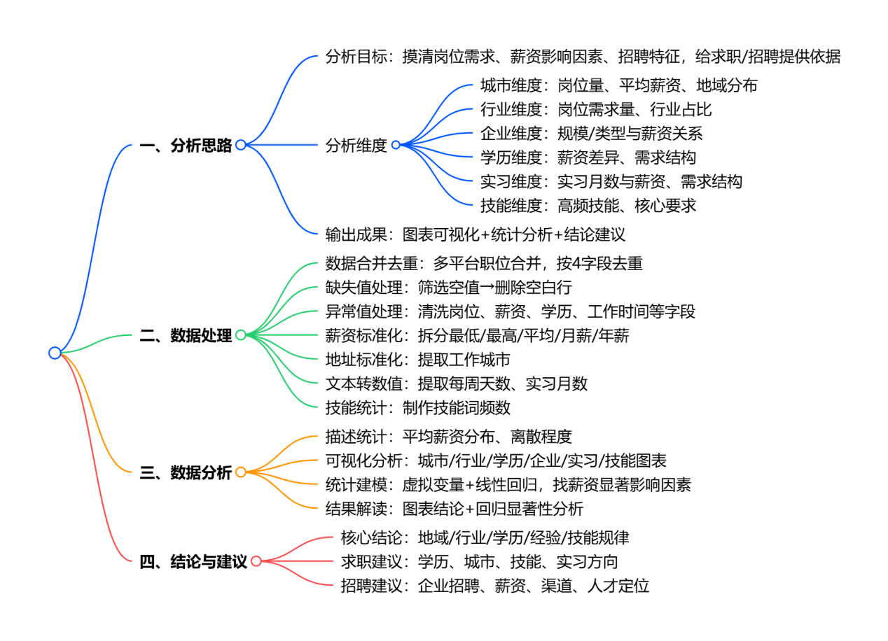

| 环节 | 阶段任务 | 使用软件 | 类别 |
| --- | --- | --- | --- |
| ① 数据采集 | 抓取招聘平台岗位数据 | 八爪鱼采集器 | 爬虫 / 数据采集 |
| ② 数据处理 | 去重、缺失值、异常值、薪资标准化 | Excel | 数据清洗 |
| ③ 统计分析 | 描述统计、直方图、箱线图、线性回归 | SPSS | 统计分析 |
| ④ 数据可视化 | 多维度图表 + 仪表板 | Tableau | BI 可视化 |
| ⑤ 分析报告 | 结论、建议、参考文献、附录 | Office | 报告输出 |

---

## 二、数据集说明

原始数据采集自主流招聘平台公开招聘条目，筛选关键词 **「产品经理实习生」**，剔除非实习、社招岗位。数据集文件：[`assets/data/原始招聘数据.xlsx`](assets/data/原始招聘数据.xlsx)，内含三个工作表，对应分析全流程的三个阶段：

| 工作表 | 含义 | 规模 |
| --- | --- | --- |
| `1.原始数据` | 八爪鱼采集的原始招聘信息（未清洗） | 1215 行 × 31 列 |
| `2.操作数据` | 去重、缺失值与异常值处理后的中间数据 | 979 行 × 19 列 |
| `3.薪资操作（实验三结果）` | 最终标准化数据（含薪资拆分、字段提取、技能频数公式） | 979 行 × 27 列 |

### 字段结构

| 分析维度 | 字段名称 | 业务含义 |
| --- | --- | --- |
| 岗位维度 | 岗位名称 | 区分产品经理实习岗位 |
|  | 学历要求 | 企业招聘的学历门槛 |
|  | 实习月数 | 实习时长要求 |
| 薪资维度 | 原始薪资 | 招聘信息中的日薪 |
|  | 最低 / 最高 / 平均薪资 | 标准化后可分析薪资 |
| 求职维度 | 每周工作天数 | 实习出勤要求 |
| 地理维度 | 工作城市 | 岗位所在城市 |
| 企业维度 | 公司名称 | 招聘企业 |
|  | 行业 | 企业所属行业 |
|  | 企业类型 | 民营、外资等属性 |
|  | 公司规模 | 企业人员规模 |
| 技能维度 | 岗位要求、技能词 | 岗位所需能力与技能 |

---

## 三、核心方法与代码

### 3.1 Excel 数据清洗核心公式

清洗工作在 `3.薪资操作` 表中完成，关键计算列均以 Excel 公式实现，可随原始数据自动复算。

```excel
// ① 薪资逻辑校验：判断最高薪资是否 ≥ 最低薪资，标记异常行
// H 列 = 最高薪资（天），G 列 = 最低薪资（天）
// VALUE() 把文本型数字转成数值后再比较；不满足最高≥最低则标记异常
=IF(VALUE(H3)>=VALUE(G3),"正常","异常（最高<最低）")

// ② 平均日薪：取最低、最高薪资的算术平均
// G 列 = 最低薪资，H 列 = 最高薪资
=(G2+H2)/2

// ③ 每周工作天数：工作时间格式统一为「x天/周」，LEFT 提取首位数字
// L 列 = 工作时间（原始），例如「5天／周」→ 提取出 5
=LEFT(L2,1)

// ④ 实习月数：实习期格式统一为「实习x个月」，MID 从第 3 位起取 1 个字符
// N 列 = 实习期（原始），例如「实习6个月」→ 提取出 6
=MID(N2,3,1)

// ⑤ 技能词频统计：在岗位要求列 R 中，统计技能词 S2 出现的次数（模糊匹配）
// 通配符 * 表示前后任意字符，实现包含即计数
=COUNTIF(R:R,"*"&S2&"*")
```

**清洗规则汇总：**

| 字段 | 清洗规则 |
| --- | --- |
| 岗位名称 | 删除与「产品经理 / 产品实习生」不相关的岗位 |
| 薪资 | 仅保留「xxx/天」「xxx-xxx/天」格式，删除面议、格式错误数据 |
| 学历 | 仅保留本科、硕士、大专、学历不限 |
| 工作时间 | 仅保留「x天/周」格式 |
| 实习期 | 仅保留「实习x个月」格式 |
| 公司规模 | 统一为 15人以下 / 15-50 / 50-150 / 150-500 / 500-2000 / 2000人以上 |
| 城市 | 删除「全国」等无具体城市数据 |
| 行业 | 删除「不限」等无效行业 |

### 3.2 SPSS 统计建模要点

- **对数转换**：原始平均日薪右偏严重，先对薪资取自然对数生成「对数平均薪资」，改善分布形态后再建模（`转换 → 计算变量`）。
- **描述性统计**：`分析 → 描述统计 → 描述`，输出均值、标准差、方差等离散指标。
- **箱线图**：`图形 → 图表构建器 → 箱图`，对数平均薪资为 y 轴，学历 / 企业类型 / 公司规模 / 每周工作时间 / 实习月数为 x 轴。
- **虚变量编码**：对学历、公司规模、企业类型三个定性变量创建虚变量，每类保留一种作为基准组，其余转为 0/1 定量变量。
- **线性回归**：`分析 → 回归 → 线性`，因变量为对数平均薪资，自变量为各虚变量；在 0.05 显著性水平下判断系数显著性。

### 3.3 Tableau 可视化字段映射

| 图表 | 列（维度） | 行（度量） | 标记 / 计算 |
| --- | --- | --- | --- |
| 城市岗位需求柱状图 | 城市 | 记录数 | 降序，城市入颜色、记录数入标签 |
| 行业岗位需求条形图 | 行业 | 记录数 | 水平条，降序 |
| 城市薪资矩阵树图 | 城市 | 平均日薪（平均值） | 矩阵图，城市入颜色 |
| 规模薪资对比图 | 公司规模 | 平均日薪（平均值） | 条形图 |
| 企业类型薪资对比图 | 企业类型 | 最低 / 最高薪资（平均值） | 双轴：最低条形 + 最高折线 |
| 学历薪资对比图 | 学历 | 平均日薪（平均值） | 条形图，降序 |
| 学历 / 实习月数结构占比 | 学历 / 实习月数 | 记录数 | 饼图 |
| 技能词云（填充气泡） | 技能词 | 频数 | 填充气泡图 |

---

## 四、关键结果

### 4.1 薪资分布与离散程度

样本量充足，平均日薪资处于中等区间，但标准差与方差较大，不同岗位薪资差异明显、离散度高，薪资受学历、企业规模、企业类型等多种因素共同影响。

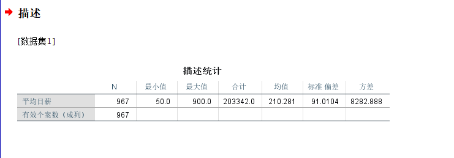

对数转换后直方图近似服从正态分布，峰值集中在中间区间，左侧陡峭、右侧轻微长尾，低薪岗位数量更多；对数转换有效改善了原始薪资的右偏特征，更符合后续建模的分布要求。


### 4.2 薪资影响因素（箱线图）

| 分类变量 | 核心结论 |
| --- | --- |
| 学历 | 学历越高薪资中位数越高，硕士最高、本科次之、大专最低，学历与薪资显著正相关，是核心因素 |
| 企业类型 | 外资、合资与民营企业薪资中位数更高，国企、事业单位与社会团体偏低且集中，影响弱于学历 |
| 公司规模 | 规模越大薪资越高，2000 人以上显著高于其他，小微为吸引人才也较高，中型企业竞争力较弱 |
| 每周工作时间 | 工作天数越多薪资整体上升，高强度岗位上限更高，箱体部分重叠，正相关但非决定因素 |
| 实习月数 | 实习时间越长薪资越高，长期实习上限更高、离散度更大，短期实习普遍偏低，正向推动但幅度温和 |

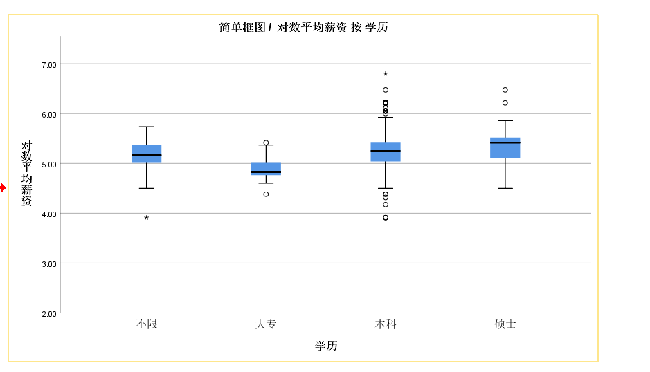

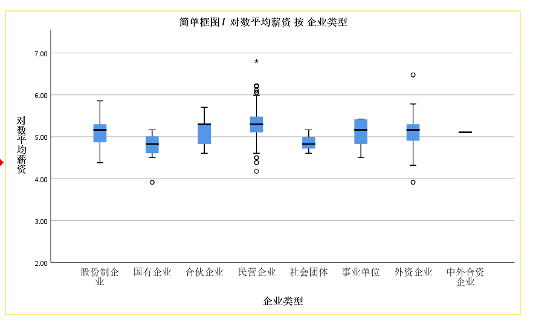


### 4.3 线性回归结果

在 0.05 显著性水平下，**学历=不限、学历=大专、企业类型=国有企业、企业类型=民营企业、公司规模=2000人以上** 5 个自变量 P 值均小于 0.05，对对数平均薪资存在显著影响：民营企业与 2000 人以上大型企业系数为正（薪资显著更高）；学历不限、大专、国有企业系数为负（薪资显著低于对应基准组）；其余变量 P>0.05，不具统计学显著性；模型常量项显著，截距项成立。

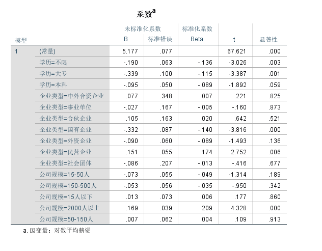

### 4.4 招聘需求分布（Tableau 可视化）

**城市分布**：北京（407）、上海（295）岗位数量领先，深圳、广州、杭州次之，二三线城市极少，头部城市垄断、地域极度不均衡。


**行业分布**：互联网 / 游戏 / 软件占绝对主导（691 个岗位），金融、电子通信、教育次之，传统行业极少。

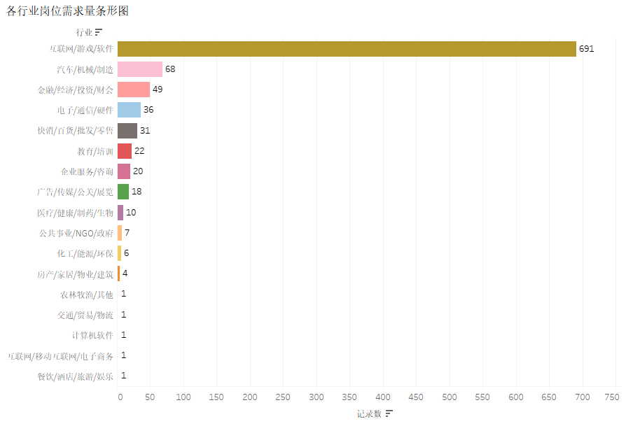

**城市薪资**：深圳（229.0）、北京（225.3）、上海（213.9）平均日薪前三，新一线中等，小城市偏低，经济越发达薪资优势越明显。

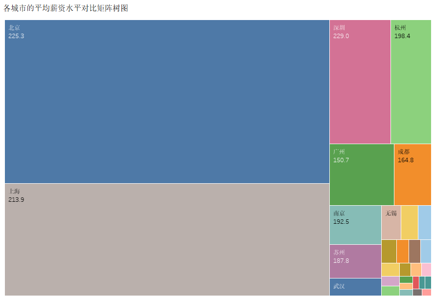

**公司规模薪资**：2000 人以上最高（226.45），15 人以下小微次之（192.17），中型企业偏低，呈两极分化。

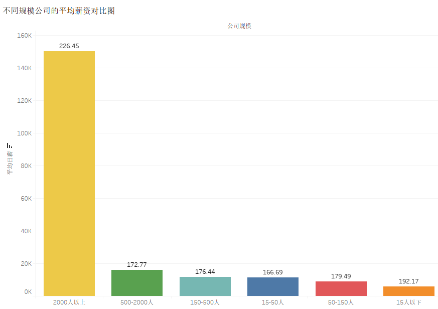

**企业类型薪资**：民营上限最高（251.1）、弹性大；国企下限偏低（132.4）、区间窄、稳定性强；事业单位与社会团体整体偏低且波动小。

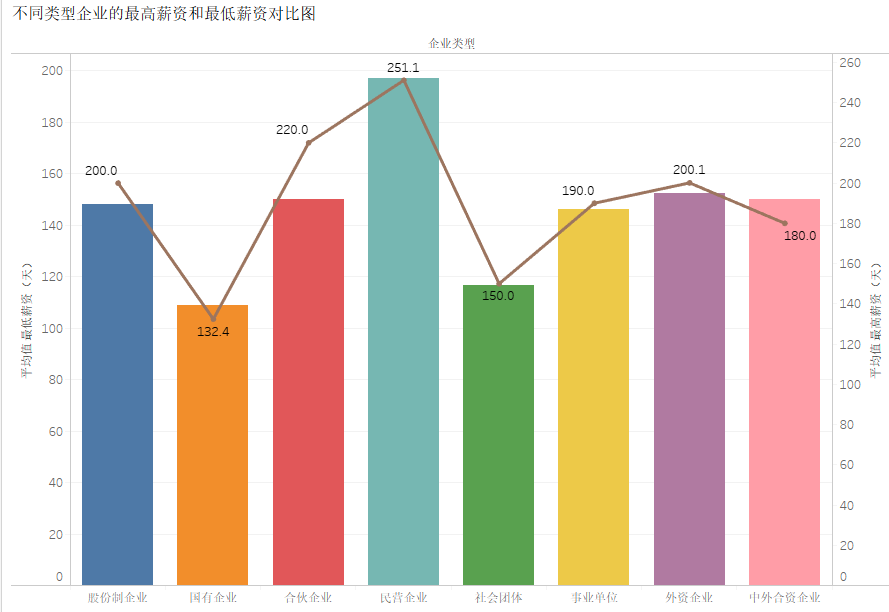

**学历薪资**：硕士（224.10）最高、本科（213.64）次之、不限（179.60）与大专（141.56）依次降低，大专竞争力明显偏弱。

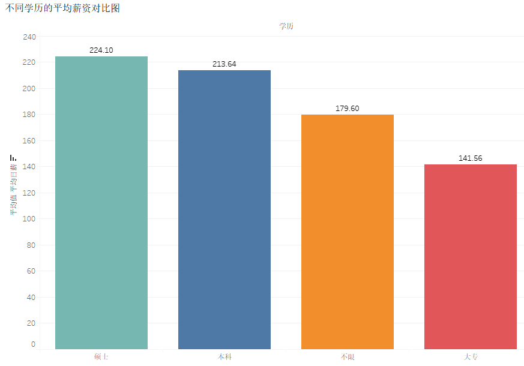

**学历需求结构**：本科占比最大（824），是招聘绝对主流；不限（77）、硕士（50）、大专（16）需求占比均很低。


**实习月数薪资**：实习越长薪资越高，8 个月（300.0）、7 个月（275.0）最高，1–2 个月最低。


**实习月数需求结构**：企业偏好 3–6 个月中短期实习，3 个月占比最高，长期与极短期需求偏少。

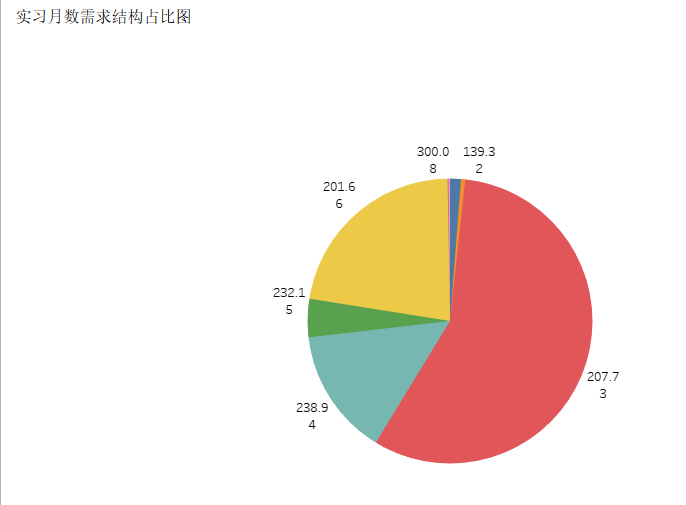

**岗位技能词云**：数据分析、沟通能力、AI 技能出现频率最高，SQL、用户反馈、英语、项目管理次之，技术能力与综合软实力并重。


**综合仪表板**：整合城市、行业、薪资、规模、学历、实习时长、技能等多维度信息，全面呈现招聘全貌。

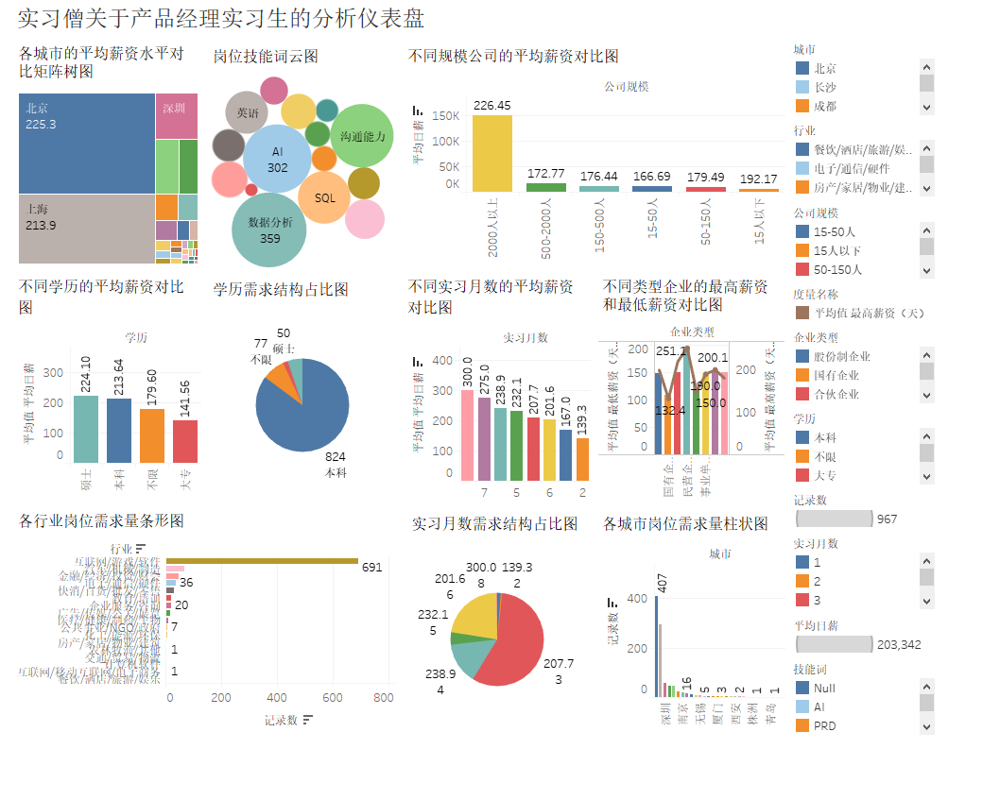

---

## 五、结论与建议

### 5.1 结论

1. **地域**：岗位资源地域分化明显，北上深杭一线及新一线城市供给领先，聚集大部分招聘需求与高薪岗位，三四线岗位稀缺；
2. **行业**：互联网软件行业是主要需求来源，占据整体招聘体量绝大部分，金融、文创等仅有零星需求；
3. **学历**：企业以本科学历为核心招聘标准，本科岗位选择最多、薪资居中，硕士薪资最优但名额少，大专可选岗位少且薪资偏低；
4. **企业属性与规模**：千人以上大型企业与民营企业实习薪资整体更高，国企偏低但稳定性强，中型企业薪资竞争力薄弱；
5. **实习周期**：企业普遍偏好 3–6 个月中短期连续实习，时长越长对应薪资越高；
6. **技能**：数据分析、沟通协作、基础 AI 应用是硬性核心技能，SQL、竞品分析、PRD 为高频专业要求。

### 5.2 建议

- **企业招聘端**：在一线核心城市集中开展校招宣讲与线下面试，低线城市线上投放轻量化信息；聚焦互联网相关院校定向合作；以本科为主力招录条件，高薪核心岗位适度放宽至硕士；中型企业适度上调实习薪资、优化福利；设置标准化 3–6 个月实习制度；面试重点核查数据分析、AI、沟通等核心技能。
- **学生求职端**：优先投递一线城市；深耕互联网领域知识；大专学历优先提升至本科，本科在校生夯实专业技能冲刺大厂高薪实习；追求高薪投大型民企、上市大厂，求稳可选国企事业单位；预留 3–6 个月完整空档期，主攻数据分析、AI、沟通等核心技能。

---

## 六、仓库结构

```
product-manager-intern-data-analysis/
├── README.md                        # 项目说明（本文件）
├── assets/
│   ├── data/
│   │   └── 原始招聘数据.xlsx         # 原始 / 操作 / 最终清洗 三个工作表
│   └── images/                     # 精选结果图表（20 张）
│       ├── 图86-分析思路图.png
│       ├── 图95-各城市岗位需求量柱状图.png
│       ├── 图105-招聘数据综合仪表盘图.png
│       └── ...
└── docs/                           # 详细报告文档（可选）
```

---

## 附：主要参考文献

1. 何晓群. 应用回归分析（第 5 版）[M]. 中国人民大学出版社，2019.（SPSS 线性回归建模理论参考）
2. 陈哲. Tableau 数据可视化实战指南 [M]. 人民邮电出版社，2022.（可视化图表制作规范参考）
3. 李军. 招聘数据分析与人力资源量化管理 [M]. 机械工业出版社，2023.（招聘业务分析逻辑参考）
4. 中国互联网行业应届生就业发展白皮书（2025）[R]. 中国信通院，2025.（行业招聘宏观背景参考）

---

*本项目为课程大数据分析综合实践项目，数据仅用于教学分析，不构成任何就业或招聘建议。*
