# 产品经理实习生招聘数据分析项目

> 一个从零到一的完整大数据分析项目：数据采集 → Excel 数据清洗 → SPSS 统计分析 → Tableau 可视化 → 综合分析报告，全程自采数据、自跑流程、自带操作截图与结果图表。

本项目以「产品经理实习生」岗位为研究对象，使用**八爪鱼采集器**从主流招聘平台抓取真实招聘数据，再依次经过 **Excel 数据清洗、SPSS 统计分析、Tableau 数据可视化**三大环节，最终产出一份完整的招聘市场数据分析报告，并沉淀为一套可复现、可上传 GitHub 的项目工程。


***

## 一、项目背景

### 1.1 研究背景

数字互联网行业持续扩张，产品经理岗位作为互联网核心职能，实习生招聘成为企业储备人才、降低用工成本的重要途径；同时经管、计算机相关在校学生普遍将产品实习作为求职入门首选。当前不同城市、企业规模、学历条件对应的实习薪资、岗位需求差异显著，招聘市场信息碎片化，企业招人、学生求职均存在信息不对称问题。基于各大招聘平台公开的产品经理实习生招聘数据，开展量化数据分析具备现实业务价值。

### 1.2 分析目的


* 挖掘产品经理实习生岗位在**城市、行业、企业类型、公司规模、学历、实习时长**六大维度的招聘分布规律；

* 量化各类因素对实习日薪的影响程度，明确薪资核心驱动因子；

* 从企业招聘端、学生求职端双向输出落地建议，优化企业招聘投放策略与在校生实习规划；

* 通过**数据清洗、统计建模、可视化**全流程，完成招聘数据标准化分析。

### 1.3 数据来源说明

本报告原始数据采集自主流招聘平台公开招聘条目，筛选关键词 **「产品经理实习生」**，剔除非实习、社招岗位，最终采集有效样本数据，字段覆盖岗位基础信息、薪资、用工条件、企业属性、岗位任职要求。

### 1.4 项目流程与技术栈

项目整体遵循标准数据分析流程，各环节使用对应专业软件：


| 环节      | 阶段任务              | 使用软件    | 类别        |
| ------- | ----------------- | ------- | --------- |
| ① 数据采集  | 抓取招聘平台岗位数据        | 八爪鱼采集器  | 爬虫 / 数据采集 |
| ② 数据处理  | 去重、缺失值、异常值、薪资标准化  | Excel   | 数据清洗      |
| ③ 统计分析  | 描述统计、直方图、箱线图、线性回归 | SPSS    | 统计分析      |
| ④ 数据可视化 | 多维度图表 + 仪表板       | Tableau | BI 可视化    |
| ⑤ 分析报告  | 结论、建议、参考文献、附录     | Office  | 报告输出      |

分析思路如下图所示：


***

## 二、阶段一：数据采集（八爪鱼爬虫）

### 2.1 任务目标

使用八爪鱼采集工具从招聘网站中采集「产品经理实习生」岗位的招聘数据，至少包含职位名称、薪资、公司名称、公司规模、公司类型或经营范围、工作地点等指标，并导出为 Excel 文件。

### 2.2 操作步骤

**Step 1｜查找目标网站并复制网址**

在浏览器打开需要采集的招聘网站，搜索并设定好关键词「产品经理实习生」，复制当前页面网址。


**Step 2｜新建采集任务并登录账号**

打开八爪鱼采集器，在「新建」处输入网址并确定；进入采集页后取消自动识别，打开浏览模式，登录私人账号。


**Step 3｜选择采集范围与数据**

关闭浏览模式后，点击下方招聘信息的大范围，依次执行「选中全部子元素 → 选中全部相似组 → 选中元素中数据内容」，等待下方数据预览区域加载好数据。


**Step 4｜设置点入链接进入详情页**

选中某个职位名称，点击操作提醒中的「点击该链接」，进入招聘详情页。


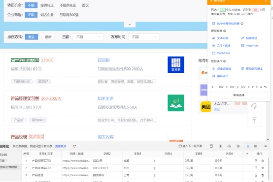

**Step 5｜详情页采集信息**

进入详情页后取消自动识别，点击需要采集的信息字段，点击操作提示中的「文本内容」把内容加载到数据预览处，再点击循环列表回到首页。


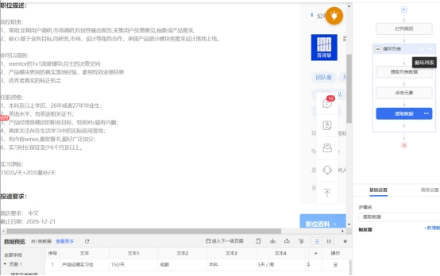

**Step 6｜设置翻页**

把页面拉到最后，点击「下一页」图案，再点击操作提示的「循环列表」，实现多页数据抓取。


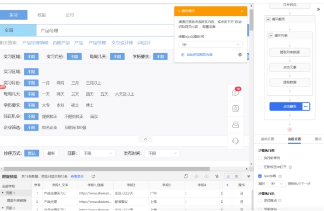

**Step 7｜翻页高级设置**

点击右侧「循环翻页」→「高级设置」，勾选「执行前等待」「等待指定元素出现」「ajax 加载」，设置超时 3 秒强制执行下一步。


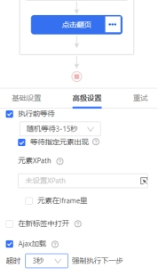

**Step 8｜提取列表数据高级设置**

点击右侧「提取列表数据」→「高级设置」，勾选「执行前等待」「等待指定元素出现」。


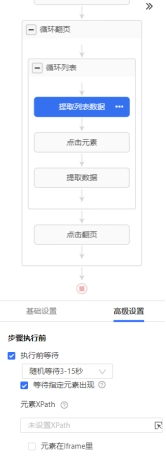

**Step 9｜启动采集**

全部设置完成后，点击右上角「采集」，选择「本地采集」。


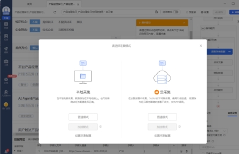

**Step 10｜登录后正式爬取**

点击本地采集后先停止，点击右上角「显示网页」进行账号登录；登录完成后返回页面，点击「启动」开始爬取。


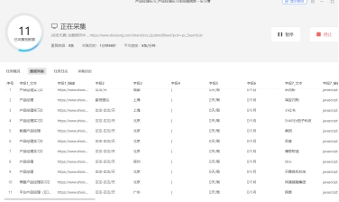

**Step 11｜导出数据**

等到采集到目标数据后点击「停止」，导出为 Excel 形式文件保存。

### 2.3 采集结果

本次实验通过八爪鱼工具成功采集目标招聘网站岗位数据 **1214 条**，完整获取了职位名称、薪资、公司信息及工作地点等关键字段，数据结构规范、可用于后续分析。采集过程中网页加载、翻页与字段提取均正常，整体采集效率与数据质量满足实验要求，导出的 Excel 文件格式符合提交规范。


***

## 三、阶段二：Excel 数据处理与清洗

### 3.1 任务目标

对采集到的岗位招聘数据进行全流程清洗，包括：多源数据合并去重、缺失值处理、异常值处理、薪资标准化、工作地点字段提取、文本字段数值化、技能词频统计，最终输出标准化可分析数据集。

### 3.2 数据合并与去重

**Step 1｜筛选保留有用列**

在「1. 原始数据」表中删除重复 / 无关列，统一设置好各列名称，得到表「2. 操作数据」。


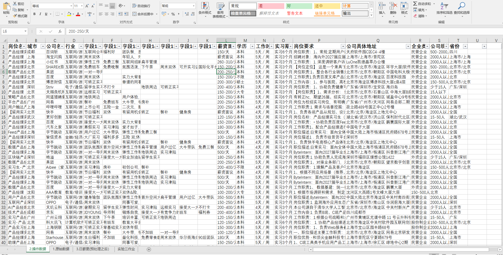

**Step 2｜删除重复值**

在表 2 中选中某一单元格，点击「数据 → 删除重复值」，选择扩展区域后取消全选，只勾选**岗位名称、公司名称、公司具体地址、薪资**四列作为重复判定标准，点击确定。


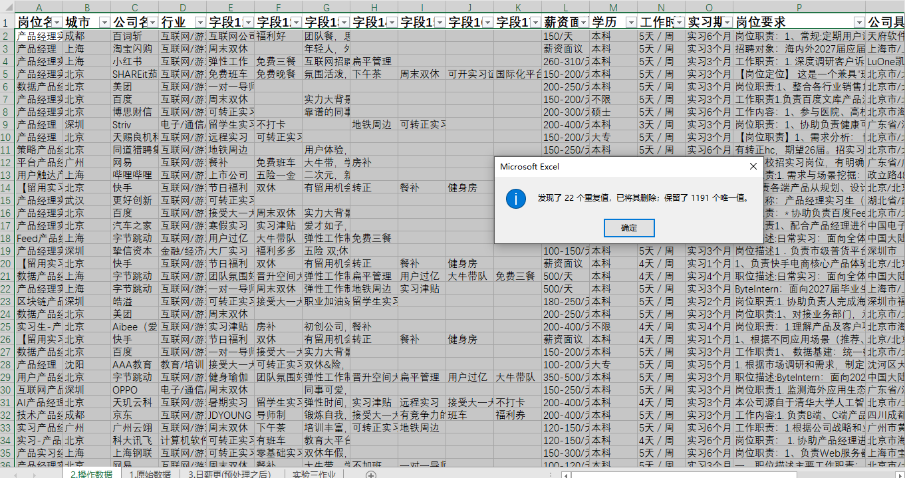

### 3.3 缺失值处理

点击第一列表头，打开「开始 → 排序与筛选 → 筛选」，一列一列排查空白值，把存在空白、缺失关键信息（岗位、薪资、城市、学历等）的列直接删除，保证数据完整有效。


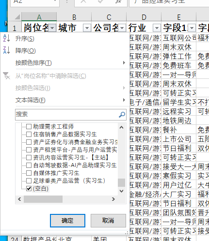

### 3.4 异常值处理

逐列排查异常数据，按业务规则清洗：


| 字段   | 清洗规则                                                                                      |
| ---- | ----------------------------------------------------------------------------------------- |
| 岗位名称 | 删除与「产品经理 / 产品实习生」不相关的岗位数据                                                                 |
| 薪资   | 仅保留「xxx / 天」「xxx-xxx / 天」格式，删除薪资面议、格式错误数据                                                 |
| 学历   | 仅保留本科、硕士、大专、学历不限，删除其他异常学历                                                                 |
| 工作时间 | 仅保留「x 天 / 周」格式，删除不规范内容                                                                    |
| 实习期  | 仅保留「实习 x 个月」格式，删除异常记录                                                                     |
| 公司规模 | 统一规范为 15 人以下 / 15-50 / 50-150 / 150-500 / 500-2000 / 2000 人以上，修正「少于 15 人」为「15 人以下」，删除错误规模 |
| 城市   | 删除「全国」等无具体城市数据                                                                            |
| 行业   | 删除「不限」等无效行业                                                                               |


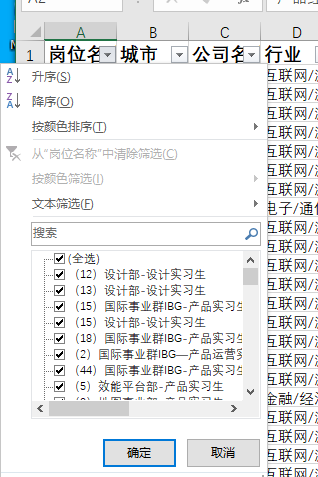


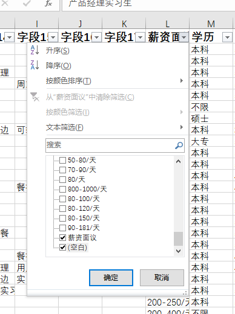


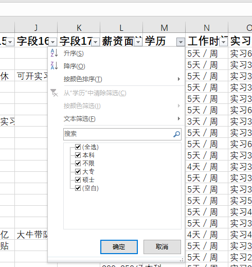


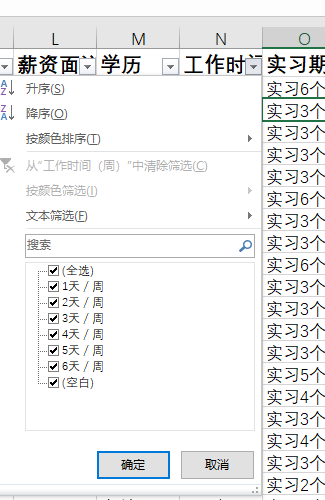


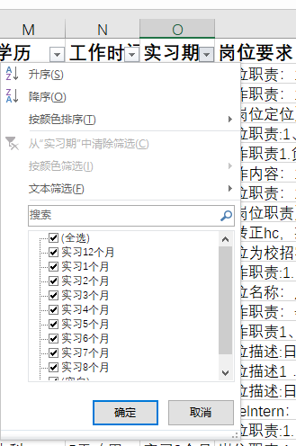


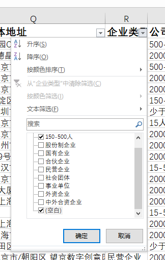


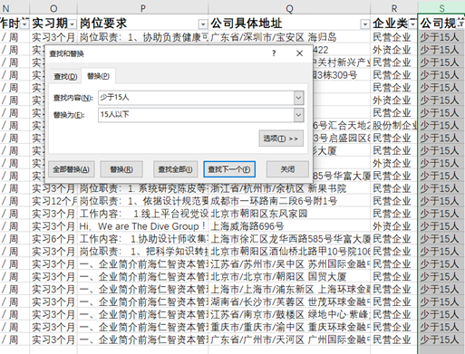


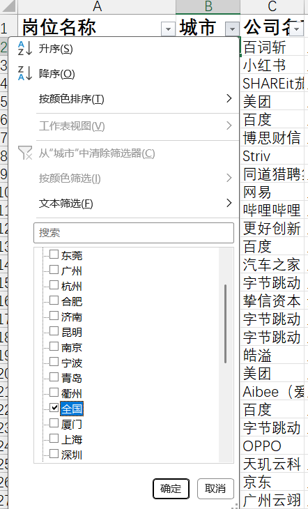


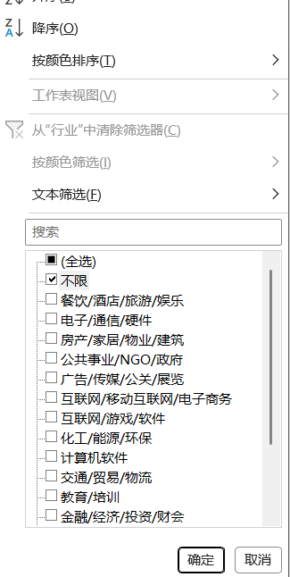

### 3.5 薪资字段标准化处理

**Step 1｜建立薪资操作表**

复制「2. 操作数据」为「3. 薪资操作」表，把主要字段移到前面，次要字段移到后面。


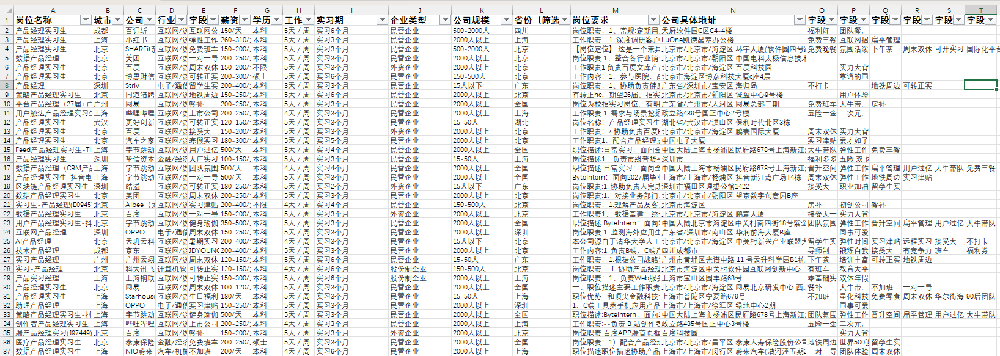

**Step 2｜分列拆分最高 / 最低薪资**

在薪资原始列旁新建 2 列空白列（最高薪资、最低薪资），用「分列」功能把「x-x / 天」格式拆分为最高、最低薪资。


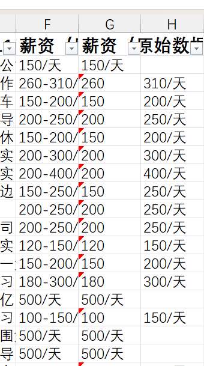

**Step 3｜处理薪资格式**

在最低、最高薪资列用「替换」功能删除「/ 天」内容，转为纯数值。


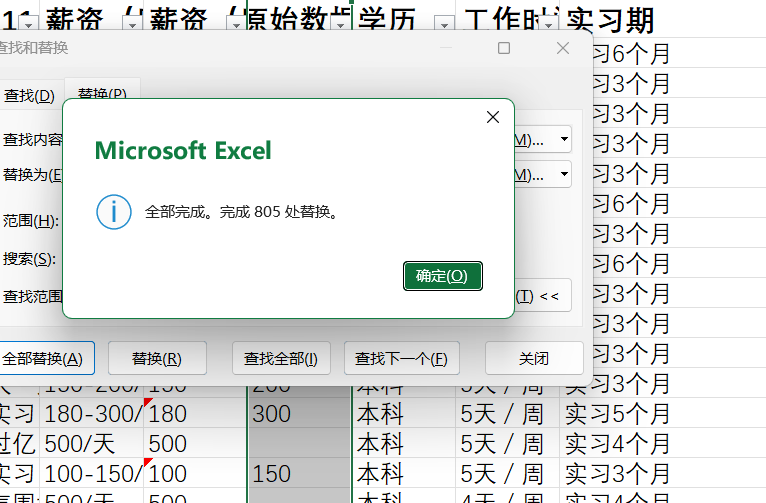

**Step 4｜补齐最高薪资空值**

筛选出最高薪资为空的数据，用公式以最低薪资填充，再把最高薪资列复制粘贴为数值，去除公式。


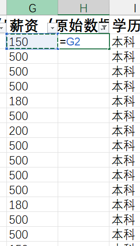

**Step 5｜薪资逻辑校验**

用公式判断最高薪资是否 ≥ 最低薪资，打开筛选查看异常数据，确保无逻辑异常。


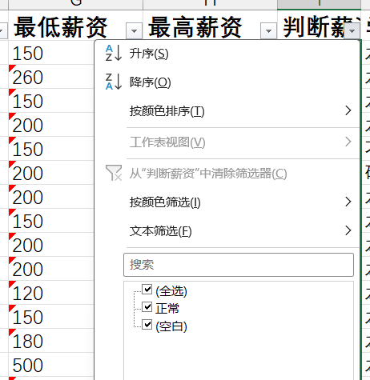

**Step 6｜计算平均薪资**

新建「平均薪资」列，用公式 `(最低薪资 + 最高薪资) / 2` 计算并填充至全部行。


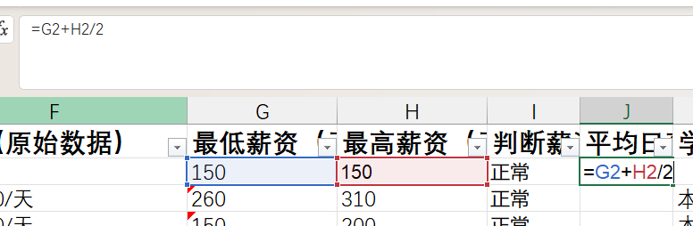

### 3.6 文本字段数值化提取

**Step 1｜提取每周工作天数**

在工作时间列旁新建「每周工作时间（天数）」列，因格式统一为「x 天 / 周」，使用 `LEFT` 公式提取第一位数字作为天数，向下填充。


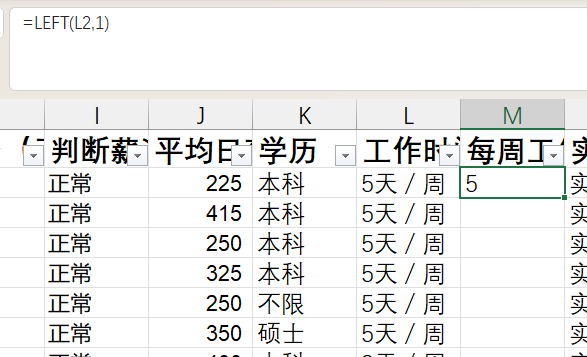

**Step 2｜提取实习月数**

在实习期旁新建「实习月数」列，因格式为「实习 x 个月」，使用 `MID` 函数提取月数，填充至全部空白列。


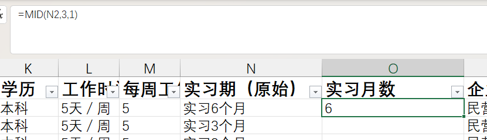

### 3.7 岗位技能词频统计（附加题）

在岗位要求列旁列出产品经理常见技能词，新建频数列，使用 `COUNTIF` 函数统计各技能词在岗位要求中的出现频次，供后续词云与技能分析使用。


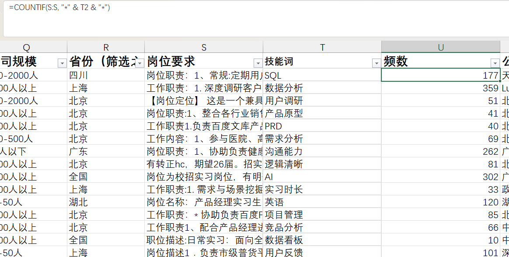

### 3.8 数据格式统一与保存

将所有数值列复制粘贴为「值」格式，去除公式；最终处理完成的数据以 Excel 文件格式保存，用于后续 SPSS 统计与 Tableau 可视化分析。

### 3.9 处理结果

本次实验围绕实习招聘数据集，完成了从原始杂乱数据到标准化可分析数据的全流程清洗与校验：


* **缺失值处理与字段补全**：针对最高薪资空值，通过条件公式实现「空值自动用对应最低薪资填充」，确保薪资字段无缺失；

* **异常值校验与修正**：构建薪资逻辑校验规则，批量检查「最高薪资是否 ≥ 最低薪资」，对异常数据标记并修正，保证业务逻辑合理性；

* **文本字段拆分与标准化**：精准提取实习期等文本字段中的数字，生成标准化「实习月数」字段；

* **数据格式统一**：解决文本型数字、隐藏字符、格式不统一导致的公式误判问题，确保字段类型一致。

处理后的数据完整性、准确性、一致性均得到保障，为后续岗位分析与统计提供了可靠的数据基础。


***

## 四、阶段三：SPSS 统计分析

### 4.1 任务目标

运用 SPSS 对清洗后的岗位招聘数据做统计分析：平均薪资描述性统计、平均薪资直方图、自变量与因变量的箱线图、定性变量虚变量创建、线性回归分析。

> 因平均日薪原始数据右偏严重，先对薪资取对数（
>
> `转换 → 计算变量`
>
> ）生成「对数平均薪资」，改善数据分布形态后再建模。

### 4.2 平均薪资描述性统计

`分析 → 描述统计 → 描述 → 确定`


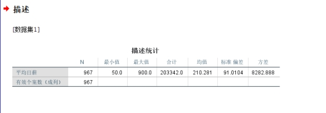

### 4.3 对数平均薪资直方图

`图形 → 图表构建器 → 选择直方图 → 把对数平均薪资拉到 x 轴 → 确定`


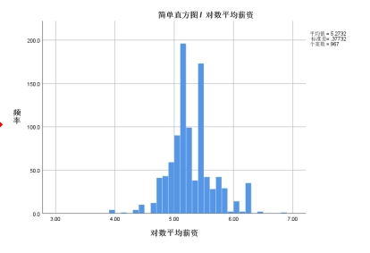

### 4.4 自变量与因变量的箱线图

统一操作：`图形 → 图表构建器 → 选择箱图 → 把对数平均薪资拉到 y 轴、分类变量拉到 x 轴 → 确定`；得到结果后双击图，点击 x 轴把最小值改为 2，删除标签。


| 箱线图              | 分类变量（x 轴） |
| ---------------- | --------- |
| 学历与对数平均薪资箱线图     | 学历        |
| 企业类型与对数平均薪资箱线图   | 企业类型      |
| 公司规模与对数平均薪资箱线图   | 公司规模      |
| 每周工作时间与对数平均薪资箱线图 | 每周工作时间    |
| 实习月数与对数平均薪资箱线图   | 实习月数      |


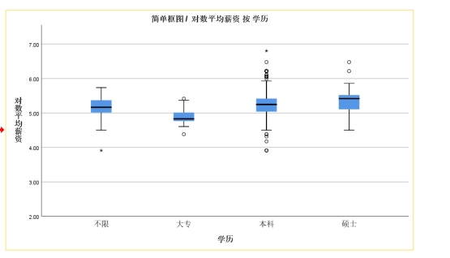


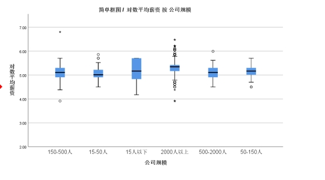


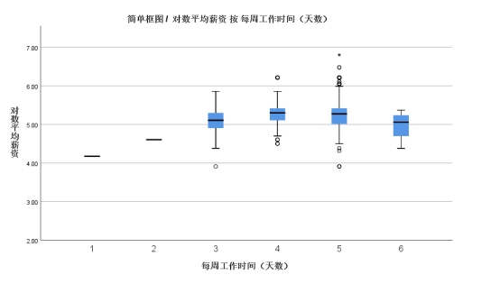


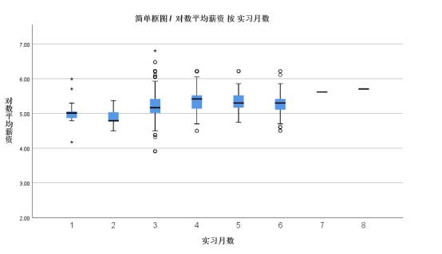

### 4.5 创建虚变量（虚拟变量）

对学历、公司规模、企业类型三个定性变量创建虚变量：`转换 → 创建虚变量 → 把对应自变量选入框`，将定性指标转化为定量数据，解决定性变量无法直接建模的问题。


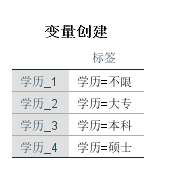

### 4.6 线性回归分析

`分析 → 回归 → 线性`：选择**对数平均薪资**为因变量，其余虚变量每类只保留一种作为基准组，其余全部选入自变量。


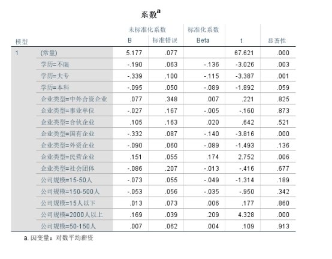

### 4.7 统计结果解读

**① 平均薪资描述性统计**

样本量充足，平均日薪资处于中等水平，但标准差较大，说明岗位薪资整体离散程度高，不同岗位间薪资差异明显，受学历、公司规模等因素影响较大。

**② 对数平均薪资直方图**

近似呈正态分布，峰值集中在中间区间，左侧陡峭、右侧略有长尾，表明低薪资岗位数量更多、高薪资岗位占比偏少，对数转换有效改善了原始薪资的偏态性。

**③ 学历箱线图**

学历越高，对数平均薪资中位数越高，箱体位置逐级上移且无明显重叠，说明学历与薪资呈显著正相关，是影响薪资的重要因素。

**④ 企业类型箱线图**

外资 / 合资企业薪资中位数最高，小微企业偏低，箱体有部分重叠，表明企业类型对薪资有一定影响，但影响程度弱于学历。

**⑤ 公司规模箱线图**

规模越大薪资箱体位置越高，500 人以上企业薪资最高，小微企业最低，箱体无明显重叠，说明公司规模对薪资影响显著。

**⑥ 每周工作时间箱线图**

工作时间越长，薪资箱体整体上移，高强度岗位薪资上限更高，箱体存在部分重叠，说明工作时间与薪资呈正相关，但并非决定性因素。

**⑦ 实习月数箱线图**

实习月数越多，薪资中位数越高，经验丰富者薪资离散度更大、上限更高，箱体重叠较多，表明实习经验对薪资有正向影响，但作用相对温和。

**⑧ 线性回归结果**

在 0.05 显著性水平下，学历 = 不限、学历 = 大专、企业类型 = 国有企业、企业类型 = 民营企业、公司规模 = 2000 人以上这 5 个自变量的显著性 P 值均小于 0.05，对对数平均薪资存在显著影响。其中民营企业、2000 人以上规模企业系数为正（薪资显著更高）；学历不限、大专、国有企业系数为负（薪资显著低于对应基准组）；其余变量 P 值均大于 0.05，不具统计学显著性；模型常量项显著，截距项成立。


***

## 五、阶段四：Tableau 数据可视化

### 5.1 任务目标

运用 Tableau 对处理好的岗位招聘数据绘制多维度图表，覆盖城市、行业、薪资、规模、企业类型、学历、实习月数、技能词等维度，并将图表组合成仪表板。

### 5.2 操作步骤

**① 各城市岗位需求量柱状图**

打开工作表 1：`记录数 → 行`，`城市 → 列`，点击降序；`记录数 → 标签`，`城市 → 颜色`；点击「整个视图」，修改标题。


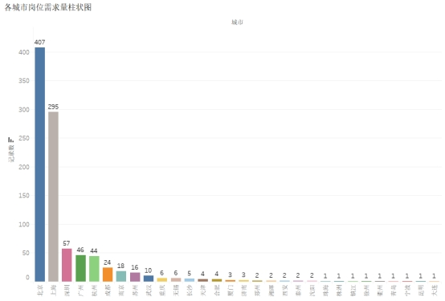

**② 各行业岗位需求量条形图**

打开工作表 2：`记录数 → 行`，`行业 → 列`，如显示柱状图则点击智能显示中的「水平条」；点击降序，`行业 → 颜色`，`记录数 → 标签`；点击「整个视图」，修改标题。


**③ 各城市平均薪资水平矩阵树图**

打开工作表 3：`城市 → 列`，`总和(平均日薪) → 行`，点击智能显示中的「矩阵图」；`城市 → 颜色`，`平均日薪 → 标签`（改为平均值）；修改标题。


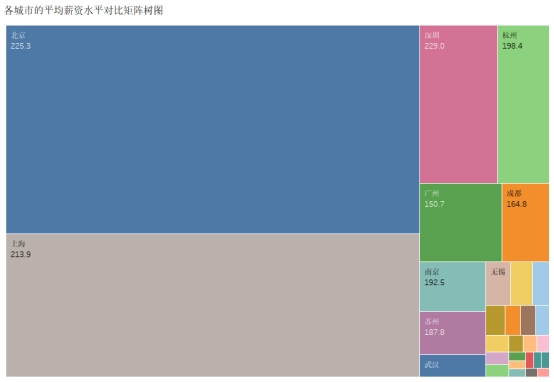

**④ 不同规模公司平均薪资对比图**

打开工作表 4：`公司规模 → 列`，`总和(平均日薪) → 行`；`公司规模 → 颜色`，`平均日薪 → 标签`（改为平均值）；修改标题。


**⑤ 不同类型企业最高 / 最低薪资对比图**

把维度「最低薪资（日薪）」数字类型改为数字（十进制）再改为度量；`企业类型 → 列`，`最低薪资、最高薪资 → 行`（均改为平均值）；最高薪资右键「双轴」，标记中最低薪资改条形图、最高薪资改折线图，最高薪资折线改褐色；`企业类型 → 最低薪资颜色`，最高薪资字段拉到标签（改为平均值）；点击「整个视图」，修改标题。


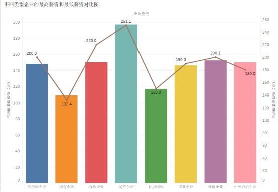

**⑥ 不同学历平均薪资对比图**

打开工作表 6：`学历 → 列`，`平均日薪 → 行`（改为平均值），标记处选条形图，点击降序；`学历 → 颜色`，`平均日薪 → 标签`；点击「整个视图」，修改标题。


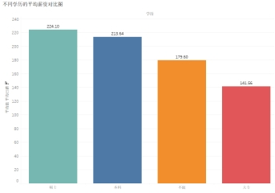

**⑦ 学历需求结构占比图**

打开工作表 7：`记录数 → 行`，`学历 → 列`，点击智能显示中的「饼图」，打开「整个视图」；`记录数、学历 → 标签`，修改标题。


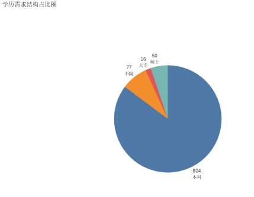

**⑧ 不同实习月数平均薪资对比图**

打开工作表 8：`实习月数 → 列`，`平均日薪 → 行`（改为平均值），标记处选条形图，点击降序；`实习月数 → 颜色`，`平均日薪 → 标签`；点击「整个视图」，修改标题。


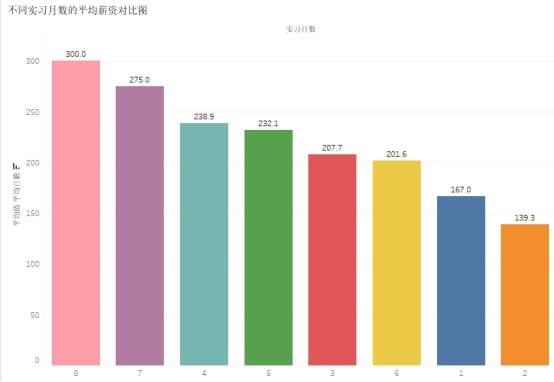

**⑨ 实习月数需求结构占比图**

打开工作表 9：`平均日薪 → 行`，`实习月数 → 列`，点击智能显示中的「饼图」，打开「整个视图」；`平均日薪 → 标签`（改为平均值），`实习月数 → 标签`，修改标题。


**⑩ 岗位技能词云图**

打开工作表 10：`技能词 → 列`，`频数 → 行`，点击智能显示中的「填充气泡图」；`频数 → 标签`，点击「整个视图」，修改标题。


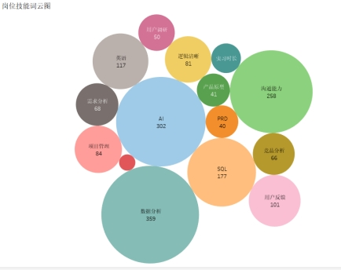

**⑪ 制作仪表板**

右键工作表 10 → 新建仪表盘，把左边的工作表拖入仪表盘中排版，勾选左下角仪表板标题并修改。


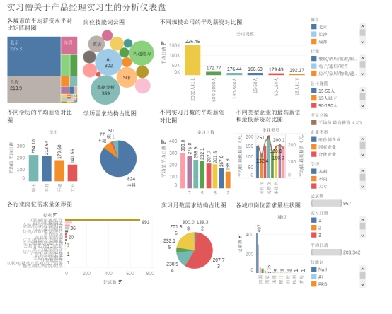

### 5.3 可视化结果解读

**① 各城市岗位需求量**：岗位需求高度集中在一线城市，北京（407）、上海（295）遥遥领先，深圳、广州、杭州等新一线次之，二三线城市极少，整体头部集中、地域不均衡。

**② 各行业岗位需求量**：互联网 / 游戏 / 软件行业需求一枝独秀（691 个岗位），占绝对主导；汽车机械、金融财会、电子通信等行业次之，传统行业偏弱。

**③ 各城市平均薪资矩阵树图**：深圳（229.0）、北京（225.3）、上海（213.9）平均日薪最高，杭州、南京、苏州中等，武汉、无锡偏低，一线城市薪资优势突出。

**④ 不同规模公司平均薪资**：2000 人以上大企业最高（226.45），15 人以下小微企业次之（192.17），150–500、500–2000 人中型企业偏低，呈两极分化。

**⑤ 不同类型企业最高 / 最低薪资**：民营最高薪资最高（251.1）、上限突出；国企最低薪资偏低（132.4）、区间窄、稳定性强；事业单位与社会团体整体偏低且波动小。

**⑥ 不同学历平均薪资**：硕士最高（224.10）、本科次之（213.64）、不限（179.60）和大专（141.56）依次降低，高学历薪资优势明显。

**⑦ 学历需求结构**：本科需求占比极高（824），是招聘主流；不限（77）、硕士（50）、大专（16）需求低。

**⑧ 不同实习月数平均薪资**：实习 8 个月最高（300.0），7 个月（275.0）、4 个月（238.9）递减，1–2 个月最低，实习越久薪资越高。

**⑨ 实习月数需求结构**：需求集中在 3 个月（占比最大），其次 6、4、5 个月，企业偏好 3–6 个月中短期实习生。

**⑩ 岗位技能词云**：数据分析、AI、沟通能力为核心技能（频率最高），SQL、用户反馈、英语、项目管理次之，PRD、竞品分析、用户调研等专业技能需求相对较少。


***

## 六、阶段五：多工具对比演练（订单明细数据集）

在正式项目之外，使用四款工具对同一份「订单明细.xlsx」数据集（1190 行、13 列）进行分析，仅统计已完成订单，对比各工具在趋势、占比、排名三类图表上的实现方式与结果一致性。

### 6.1 Excel（数据透视图）

**① 商品销售订单总趋势（折线图）**

把下单日期拉到轴、订单号拉到值（改为计数），订单状态筛选为已完成；设置数据透视图为折线图，勾选数据标签、取消图例、设置标题。


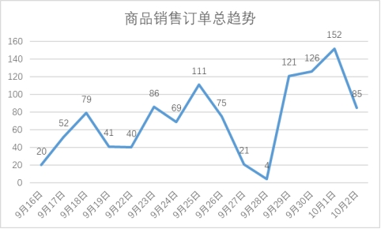

**② 各商品销量占比（饼图）**

把商品数量拉到值、商品名称拉到轴，订单状态筛选为已完成；设置饼图，数据标签勾选值、类别名称、百分比（保留两位小数）。


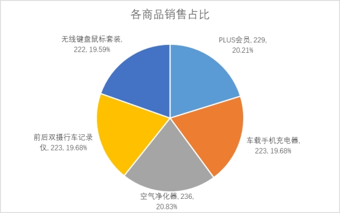

**③ 各商品销量排名（条形图）**

把商品数量拉到值、商品名称拉到轴，订单状态筛选为已完成；按商品数量升序，设置条形图，显示数据标签。


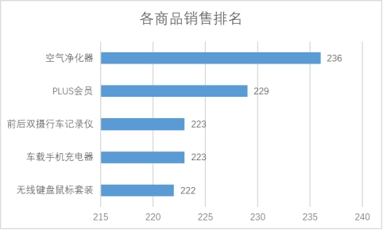

### 6.2 Tableau

**① 订单总趋势（折线图）**：把下单时间拉到列、记录数拉到行，下单时间右键选精确日期，订单状态筛选为已完成，记录数拉到标签，设置标题。


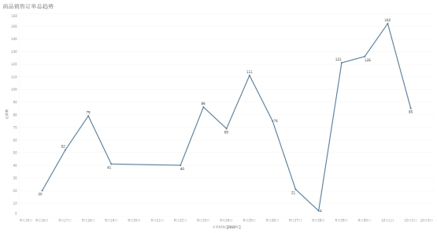

**② 各商品销量占比（饼图）**：商品名称、商品数量拉到列，选饼图，订单状态筛选为已完成；商品名称与数量拉到标签，快速表计算选合计百分比，格式保留两位小数。


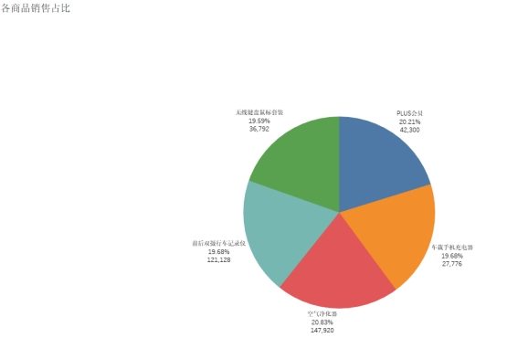

**③ 各商品销量排名（条形图）**：商品名称、数量拉到列，选饼图后点击功能区装置变为条形图，点击降序，商品数量拉到标签。


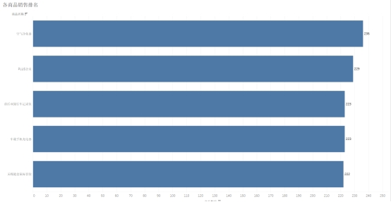

### 6.3 蓝鲸软件（工作流式分析）

通过拖拽组件搭建分析工作流，逐级查看数据信息。

**Step 1｜文件导入**：把文件拉到空白处，点击文件标识选择要导入的文件和设置相关类型。


**Step 2｜添加数据信息**：把数据信息组件拉到空白处，与文件相连，右键查看相关内容。


**Step 3｜查看数据表格**：把数据表格组件拉到空白处，与文件相连，右键查看。


**Step 4｜查看数据透视表**：把数据透视表组件拉到空白处，右键查看详细内容。


### 6.4 SPSS

**① 订单总趋势（折线图）**：数据→定义变量属性，给订单状态编码（1,2,3,4）；图表构建器选折线图，订单号拉 y 轴（总和）、下单时间拉 x 轴，订单状态筛选只保留已完成；定制标题。结果图双击编辑，勾选显示数据标签。


**② 各商品销量占比（饼图）**：图表构建器选饼图，商品数量拉 y 轴（总和）、商品名称拉 x 轴，订单状态筛选为已完成；定制标题；结果图双击勾选显示数据标签，显示商品名称和百分比。


**③ 各商品销量排名（条形图）**：图表构建器选条形图，商品数量拉 y 轴、商品名称拉 x 轴，订单状态筛选为已完成；上方功能区选统计降序，勾选显示数据标签。


### 6.5 对比结论


* **Excel**：最简单，适合快速做基础图表；

* **Tableau**：图表美观、可交互筛选；

* **蓝鲸**：适合一步步搭建工作流查看数据信息；

* **SPSS**：更专业，适合做统计图表写报告。

四款工具画出的折线趋势、饼图占比、条形排名完全一致，图表均可正常显示标题、数据标签、百分比与数值，分析结果可靠。


***

## 七、综合分析报告（结果与发现）

将以上各阶段成果系统整合，形成完整的产品经理实习生岗位招聘市场数据分析报告。

### 7.1 描述性统计

样本量充足，平均日薪资处于中等区间，但标准差与方差较大，说明不同岗位薪资差异明显、离散度高，薪资受学历、企业规模、企业类型等多种因素影响，整体分布不均衡。


### 7.2 对数平均薪资分布

对数转换后直方图近似服从正态分布，峰值集中在中间区间，左侧陡峭、右侧轻微长尾，低薪岗位数量更多，对数转换有效改善原始薪资的右偏特征。


### 7.3 薪资影响因素（箱线图）

**学历**：学历越高薪资中位数越高，硕士最高、本科次之、大专最低，学历与薪资显著正相关，是核心因素。


**企业类型**：外资、合资与民营企业薪资中位数更高，国企、事业单位与社会团体偏低且集中，企业类型影响弱于学历。


**公司规模**：规模越大薪资越高，2000 人以上显著高于其他，小微为吸引人才也较高，中型企业竞争力较弱。


**每周工作时间**：工作天数越多薪资整体上升，高强度岗位上限更高，箱体部分重叠，工作时间与薪资正相关但非决定因素。


**实习月数**：实习时间越长薪资越高，长期实习上限更高、离散度更大，短期实习普遍偏低，实习经验正向推动薪资但幅度温和。


### 7.4 线性回归

0.05 显著性水平下，学历 = 不限、学历 = 大专、企业类型 = 国有企业、企业类型 = 民营企业、公司规模 = 2000 人以上对对数平均薪资具有显著影响；民营企业与大型企业薪资显著更高，低学历与国企薪资显著更低，模型整体显著。


### 7.5 招聘需求分布（Tableau 可视化）

**城市分布**：北京、上海岗位数量领先，深圳、广州、杭州次之，二三线城市极少，头部城市垄断、地域极度不均衡。


**行业分布**：互联网 / 游戏 / 软件占绝对主导，金融、电子通信、教育次之，传统行业极少。


**城市薪资矩阵树图**：深圳、北京、上海平均日薪前三，新一线中等，小城市偏低，经济越发达薪资优势越明显。


**公司规模薪资**：2000 人以上最高，小微次之，中大型偏低，两极分化。


**企业类型薪资**：民营上限最高、弹性大；国企下限偏低、区间窄、稳定性强。


**学历薪资**：硕士最高、本科次之、不限与大专偏低，大专竞争力明显偏弱。


**学历需求结构**：本科占比最大，是招聘绝对主流，硕士、大专需求占比均很低。


**实习月数薪资**：实习越长薪资越高，8、7 个月最高，1–2 个月最低。


**实习月数需求结构**：企业偏好 3–6 个月中短期实习，3 个月占比最高，长期与极短期需求偏少。


**岗位技能词云**：数据分析、沟通能力、AI 技能出现频率最高，SQL、用户反馈、英语、项目管理次之，技术能力与综合软实力并重。


**综合仪表板**：全面呈现招聘全貌 —— 需求集中于一线及新一线、互联网主导、本科为核心、重视数据分析与沟通，薪资受城市、规模、学历、实习时长共同影响。


***

## 八、结论与建议

### 8.1 结论


1. **地域**：产品经理实习生岗位资源地域分化明显，北上深杭一线及新一线城市供给领先，聚集大部分招聘需求与高薪岗位，三四线岗位稀缺；

2. **行业**：互联网软件行业是主要需求来源，占据整体招聘体量绝大部分，金融、文创等仅有零星需求；

3. **学历**：企业以本科学历为核心招聘标准，本科岗位选择最多、薪资居中，硕士薪资最优但名额少，大专可选岗位少且薪资偏低；

4. **企业属性与规模**：千人以上大型企业与民营企业实习薪资整体更高，国企偏低但稳定性强，中型企业薪资竞争力薄弱；

5. **实习周期**：企业普遍偏好 3–6 个月中短期连续实习，时长越长对应薪资越高；

6. **技能**：数据分析、沟通协作、基础 AI 应用是硬性核心技能，SQL、竞品分析、PRD 为高频专业要求。

### 8.2 建议


* **企业招聘端**：在一线核心城市集中开展校招宣讲与线下面试，同步在低线城市线上平台投放轻量化招聘信息；聚焦互联网相关院校定向合作，精简冷门行业招聘投入；把本科作为主力招录条件，高薪核心岗位适度放宽至硕士；中型企业适度上调实习薪资、优化实习福利以提升吸引力；设置标准化 3–6 个月实习制度；在简历筛选与面试环节重点核查数据分析、AI、沟通等核心技能。

* **学生求职端**：优先去往一线城市投递，提升入职机会与薪资上限；深耕互联网领域知识，针对性投递互联网企业；大专学历优先通过学历提升至本科，本科在校生夯实专业技能冲刺大厂高薪实习；追求高薪投大型民企、上市大厂，求稳可选国企事业单位；预留 3–6 个月完整空档期，主攻数据分析、AI、沟通等核心技能。


***

## 九、数据字段说明

清洗后数据集字段结构如下：


| 分析维度      | 字段名称           | 业务含义       |
| --------- | -------------- | ---------- |
| 岗位维度      | 岗位名称           | 区分产品经理实习岗位 |
|           | 学历要求           | 企业招聘的学历门槛  |
|           | 实习月数           | 实习时长要求     |
| 薪资维度      | 原始薪资           | 招聘信息中的日薪   |
|           | 最低 / 最高 / 平均薪资 | 标准化后可分析薪资  |
| 用户 / 求职维度 | 每周工作天数         | 实习出勤要求     |
| 地理维度      | 工作城市           | 岗位所在城市     |
| 企业维度      | 公司名称           | 招聘企业       |
|           | 行业             | 企业所属行业     |
|           | 企业类型           | 民营、外资等属性   |
|           | 公司规模           | 企业人员规模     |
| 技能维度      | 岗位要求、技能词       | 岗位所需能力与技能  |


***

## 十、项目目录结构


```
产品经理实习生招聘数据分析项目/
├── README.md                      # 项目说明（本文件）
├── assets/
│   ├── images/                    # 全部操作截图与结果图表（86 张）
│   │   ├── 图14-查找网站.jpeg
│   │   ├── 图25-筛选保留有用列.png
│   │   ├── 图46-描述性统计.jpeg
│   │   ├── 图64-各城市岗位需求量柱状图.jpeg
│   │   └── ...
│   └── data/                      # 数据集（采集结果 / 清洗结果）
└── docs/                          # 详细报告文档（可选）
```


***

## 附：主要参考文献


1. 何晓群。应用回归分析（第 5 版）\[M]. 中国人民大学出版社，2019.（SPSS 线性回归建模理论参考）

2. 陈哲. Tableau 数据可视化实战指南 \[M]. 人民邮电出版社，2022.（可视化图表制作规范参考）

3. 李军。招聘数据分析与人力资源量化管理 \[M]. 机械工业出版社，2023.（招聘业务分析逻辑参考）

4. 中国互联网行业应届生就业发展白皮书（2025）\[R]. 中国信通院，2025.（行业招聘宏观背景参考）


***

*本项目为课程大数据分析综合实践项目，数据仅用于教学分析，不构成任何就业或招聘建议。*